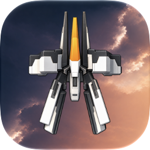
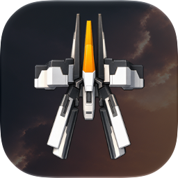
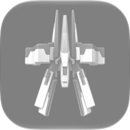

# App icon

Version 1.1 (14) replaces the earlier nearest-neighbor enlargement of the
57×57 original icon with an editable [SpaceUndeadbeef.icon](<../Icon Composer/SpaceUndeadbeef.icon>)
document. It retains the upright ship, orange center fin, white/graphite armor
and the title artwork's navy-to-peach sky.

| Light | Dark | Monochrome / clear light |
| --- | --- | --- |
|  |  |  |

## Source and authorship

The original game artwork remains attributable to its original creators.
`Resources/Original/icon.png`, `title_bg.png` and `playerShip_01.png` were the
visual references. The two 1254×1254 PNG layers in the document's `Assets` folder
are new AI-assisted reconstructions prepared for this restoration by Angelo
Cammalleri; they are not recovered high-resolution originals. No original asset,
gameplay sprite, title-screen image or executable was replaced by this work.
The ship's invented fine surface detail should not be mistaken for historical
source detail. The icon uses no text or outer mask baked into its source layers.

`Ship.png` contains the transparent ship; `TitleSky.png` is an opaque, continuous
background. The native document owns placement, shadow and appearance changes.
Dark dims the sunset while retaining the silver ship and orange fin. Mono removes
the sky and preserves ship luminance, with a restrained silhouette lift for
small-size readability. The system supplies clear/tinted appearance colors,
masking and lighting. Watch uses its circular layout and default appearance.

## Build ownership

The iOS, macOS and watchOS app targets compile only `SpaceUndeadbeef.icon` as
the primary icon. Both Debug and Release settings and `generate_project.rb`
use the matching `SpaceUndeadbeef` icon name. Xcode emits the iPhone and iPad
icon dictionaries and older-OS raster fallbacks; source plists do not duplicate
those dictionaries. Retired enlarged raster catalogs were removed.

tvOS keeps its platform catalog. `script/prepare_icons.swift` exports the sky as
the Back layer and the transparent ship as the Front layer, sharing the native
document's scale. Top Shelf composites those same layers. Background cover uses
proportional cropping rather than stretched edge columns. Native `.icon` files
are not a tvOS icon input.

## Review and verification

Run `script/export_icon_previews.sh /path/outside/repo` to export Default, Dark,
Clear Light/Dark and Tinted Light/Dark at 1024 and 64 pixels for iOS and Mac,
plus the Watch icon at 1088 and 64 pixels. This uses the selected Xcode's
`ictool`, design generation 27. The three small images above are intentional
native-rendered documentation assets; review dumps are not app resources.

Unsigned Debug builds pass for all four platforms under Xcode 27.2. The fresh
iOS compiled catalog contains Default, Dark and Tintable icon images and native
layer/group records. Its generated iPhone/iPad dictionaries both identify
`SpaceUndeadbeef`. Native previews were visually checked at full and small sizes,
including the Watch circle and Mac composition. The new icon was also visible
on the iPhone 18 Pro Simulator Home Screen. The subsequent requested physical
device rollout is recorded in [Verification.md](Verification.md). No App Store
upload, icon picker or gameplay changes are included.

### Older systems and tvOS

The signed device builds retain the same deployment minimums: iOS 18, watchOS 10
and tvOS 18. The compiled iOS and Watch catalogs include precomposed 1024×1024
icon images alongside the modern layer stacks. Xcode generates the earlier-OS
appearance from the current Composer document, rather than retaining the old
57×57 enlargement. See Apple's workflow linked below for this automatic fallback.

On 29 October 2026, the installed icon was requested directly from the physical
Office Apple TV with placeholders disabled. Its returned 1280×768 image was
visually checked and shows the new ship and sunset. The TV catalog also contains
the matching front/back parallax layers and 1×/2× Top Shelf images.

Apple's [Icon Composer workflow](https://developer.apple.com/documentation/xcode/creating-your-app-icon-using-icon-composer)
and [app-icon platform specifications](https://developer.apple.com/design/human-interface-guidelines/app-icons)
describe the platform appearances and native compilation workflow.
