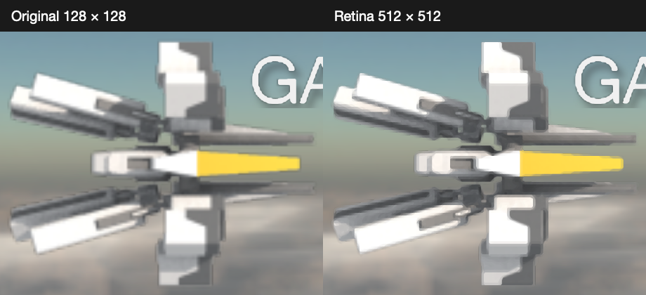

# Original player ship at Retina density

Version **1.1 (15)** adds separate prepared renditions for all 25 original
`playerShip_01.png` through `playerShip_25.png` views. No original resource or
guest executable is edited. This is a conservative, edge-aware enlargement of
the original raster art, not a new model or recovered high-resolution source.
Existing shapes, shading, orange/yellow fin and frame order remain the source
of truth. No invented panel lines or icon reconstruction is used in gameplay.

The comparison is an equal-size, unscaled crop of the same actual engine frame
at 1704×786 pixels. The original entrance animation and white fade are retained.
Diagonals and flat-color boundaries are cleaner, but absent original detail
cannot be recovered by enlarging the bitmap. These sprites intentionally retain
the original low-detail surfaces instead of imitating the reconstructed icon.

## Preparation and provenance

`Resources/Modern/PlayerShip` contains 512×512 views for the Metal hosts and
256×256 views for watchOS. They were exported offline with Zenju's
[xBRZ 1.9](https://sourceforge.net/projects/xbrz/files/xBRZ/xBRZ_1.9.zip/download),
ARGB transparency and the default filter configuration. The source archive and
its four compilation inputs are pinned by SHA-256 in
`script/prepare_retina_ships.sh`. The generated manifest records the original
PNG hash and both output hashes for every view. A second independent export
produced byte-identical PNGs and manifest.

Run `script/prepare_retina_ships.sh` to download the pinned source into temporary
storage, compile the standalone exporter and regenerate the prepared resources.
An already-downloaded source directory may be the first argument; an optional
second argument redirects exports outside the repository. Input source hashes
are still checked. All compilation and downloads are removed on exit.

The external xBRZ source and the standalone conversion utility use GPL-3.0;
the latter's license is in `script/tools/COPYING`. No scaler source, binary or
dependency is linked into or bundled with the application. The game only loads
the prepared PNGs. Original artwork attribution is unchanged.

A generated reconstruction was evaluated but rejected for changed surfaces and
stray alpha-edge pixels. That candidate is absent from app resources.

## Runtime contract and cost

The loader substitutes native pixels only for the exact original texture names
and slots 12–36. Guest records retain their original 128×128 dimensions,
power-of-two padding and UV bounds. Ship size, centering, bank selection,
entrance motion, collision, targeting and simulation code are unchanged.
Original-only resource fixtures retain their existing fallback. A present but
incomplete prepared set fails with a specific resource error instead of mixing
different densities between views.

Decoded ship storage grows from 1.5625 MiB to 6.25 MiB on Watch, an increase of
4.6875 MiB. Other hosts use 25 MiB of CPU texture storage, an increase of
23.4375 MiB, with a corresponding GPU texture upload. All 50 compressed PNGs
occupy 3,457,977 bytes. Conversion is offline; there is no scaling pass, added
draw call or per-frame conversion allocation in the game loop. Physical-device
memory pressure and sustained frame times have not been measured for this build.

## Verification

- `script/test_retina_ships.sh`: **205** AddressSanitizer/UndefinedBehaviorSanitizer
  checks pass against the actual loader and guest records. Every view and both
  export densities decode. Across all 50 silhouettes, alpha-covered area changes
  by at most **0.0857%** and centroid drift is at most **0.0098 original pixels**.
  Original-only fallback and incomplete-resource diagnostics are exercised.
- The baseline and updated actual engines receive the same 600 fixed steps and
  inputs. All original guest-memory/register, draw-state, audio-event and final
  save fingerprints match exactly. Image hashes differ as intended.
- Identically driven 1704×786 CPU renders cover the automatic entrance and normal
  gameplay. Their near-camera comparison and all 25 prepared views were inspected.
- The iPhone 18 Pro / iOS 27.2 Simulator's existing original-game interaction test
  passes: **1 test, 0 failures, 0 skips**. Actual Metal screenshots show the ship
  during gameplay/targeting; title, Options, pause, resume and background recovery
  also remain usable. The existing audio-session main-thread warnings persist.
- Debug builds pass for iOS, macOS, tvOS and watchOS; all bundles report **1.1 (15)**.
  This work does not claim physical-device installation or hardware performance.
