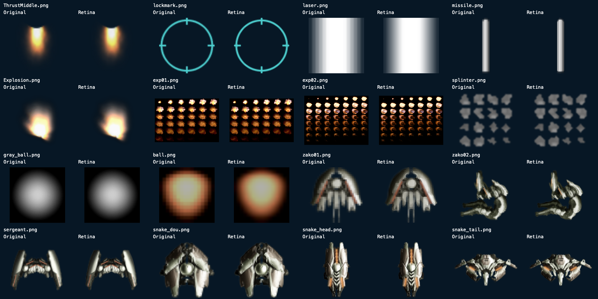

# Original gameplay sprites at Retina density

Version 1.1 (19) extends the [player-ship pass](RetinaShip.md) to every remaining
gameplay texture: thrust, target marker, laser, missile, glow, both explosion
animations, debris, both projectile balls, Zako enemies, Sergeant and the
Snake boss's head/body/tail. All 16 original slots (46–61) retain their names,
guest dimensions, padded dimensions, IDs and normalized UV coordinates.



## Export and fidelity

Hard contours use the same offline **xBRZ 1.9 ARGB/default configuration** as the
25 player-ship views. It interpolates existing source colors and reconstructs
contours; it cannot recover missing surface detail. No generative assets or
Sketchfab screenshots enter the game.

Five soft-gradient textures (thrust, laser, single explosion glow, gray ball and
colored ball) instead use centered bilinear RGBA interpolation. Applying a
contour classifier to these lights produced visible color bands in review.
Their original soft gradient, straight alpha and additive-blend behavior remain
the reference. Missile, enemy and boss contours use xBRZ.

The two explosion atlases contain **32 and 50 animation frames**. Their exact
pixel rectangles come from the original executable's AnimationData at
0x13e34, pointing to frame records at 0x115d0 and 0x10e00. The 16 debris cells
are a 4×4 grid, matching SplinterUnit::render's 0.25 UV factor at 0xaae0.
Each of these **98 cells** is scaled in isolation and returned to its original
atlas position multiplied by density. Unused cells and gaps retain their
original values at the new density. Frame order, duration, rendered size and
blend mode remain original.

Reproduce outside the app build:

```sh
./script/prepare_retina_sprites.sh /path/to/verified/xBRZ-1.9
./script/test_retina_sprites.sh
```

Omitting the source directory downloads the same hash-pinned official archive
used by the ship exporter. The GPL-3.0 offline exporter and external scaler are
never linked into an app target or bundled in the product. The license is in
[script/tools/COPYING](../script/tools/COPYING). Only generated PNGs and their
provenance manifest are app resources. The manifest pins original/output hashes,
input-layout hash, density and frame rectangles. A second export is byte-exact.
All 96 original assets and the guest executable retain their recorded hashes.

## Runtime and storage

Watch loads the prepared **2×** set; iPhone/iPad, Mac and TV load **4×**.
Native texture dimensions and POT padding grow proportionally, preserving the
original content-to-padding ratio. The interpreter still sees every original
texture record unchanged, including non-square and non-power-of-two sprites.
Missing whole sets use the original texture path; partial/invalid sets fail
explicitly. Exporting and image scaling never run during a frame.

The 32 PNGs occupy **4,079,299 bytes**. Decoded RGBA/POT storage for these 16
textures rises from **1.49 MiB** to **5.96 MiB on Watch** (+4.47 MiB), or
**23.86 MiB elsewhere** (+22.37 MiB). Metal also owns uploaded texture storage.
This is additional to the existing player-ship set; it is a density/memory
tradeoff, not a measured FPS improvement.

## Verification

**408 ASan/UBSan checks** exercise the actual loader, all guest size/UV records,
both output densities, original explosion-frame rectangles, individual cell
coverage/registration and original-only/partial-set behavior. Maximum alpha
area delta is 3.8686 original pixels; maximum centroid drift is 0.0262 original
pixels. The acceptance budget is below 2% covered area or two source pixels
for tiny cells, and below 0.3 source pixels of centroid drift.

Before/after engines match all guest-memory/register/draw/audio/save
fingerprints over the same 600 fixed steps; rendered pixels intentionally
change. The iPhone 18 Pro Simulator's original interaction test passes
(1 pass, 0 failures), including Options, Start, Pause/Resume, targeting and
foreground recovery. Its gameplay screenshots, all 16 comparisons and both
full explosion atlases were visually reviewed. The two existing audio-session
main-thread warnings remain.

All four platform Debug builds pass, report **S.deadbeef 1.1 (19)** and contain
the manifest-matching outputs. This pass includes no physical-device install,
gameplay automation or performance test.
