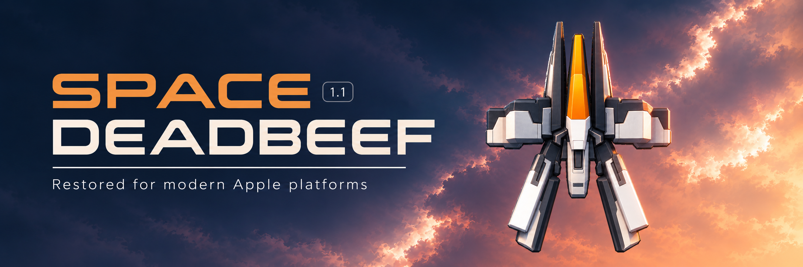

# SPACE UNDEADBEEF

**[iPhone and iPad downloads](https://github.com/ANGOmarcello/space_undeadbeef/releases)** · [Build from source](BUILDING.md) · [iCloud progress](Documentation/ICLOUD.md)

Download `SpaceDeadbeef.ipa` from Releases when available. It is an unsigned
ARM64 device build for iOS/iPadOS 18 or later. Sign it with your own account
using a sideloading tool such as [Sideloadly](https://sideloadly.io/), then install
it on your iPhone or iPad. The release includes matching source and `SHA256SUMS`.
Mac, Apple TV and Watch use their separate Xcode schemes.

## What changed in version 1.1

We raised the displayed version from the original **1.01** to **1.1** to mark
our restoration and modernization work. The original game remains the foundation;
these additions make it usable on today's Apple platforms.

- **Modern platforms:** native 64-bit hosts for iPhone, iPad, Mac, Apple TV and a standalone Apple Watch app.
- **Screen-filling layouts:** adaptive arenas, wider title art, Retina rendering, a screen-corner pause control and a compact, centered Watch HUD.
- **Faithful sharper artwork:** higher-density renditions of all player views, enemies, boss parts, weapons and effects; crisp menu text and corrected text shadows.
- **Smoother execution:** original 60 Hz simulation, display-paced presentation, batched Metal drawing, bounded asynchronous checkpoints and cached software menus.
- **Native controls:** touch, mouse, keyboard and extended controllers; direct Digital Crown steering; Apple TV menu focus and remote touch-down/drag/release gameplay.
- **Sound preferences:** sound enabled by default, respecting Silent Mode by default where supported, with persistent Options choices.
- **Optional haptics:** iPhone and Watch feedback for menus, weapons, hits and explosions, controlled through the original Options screen.
- **Interruption recovery:** noninterruptive iPhone banners keep gameplay running; real interruptions use the original resumable Pause flow and recoverable native audio.
- **Safer progress storage:** validated checkpoints and recovery records, local TV saves, and optional progress sharing. The sideloaded iPhone/iPad build uses a folder chosen in iCloud Drive; personal builds retain provisioned key-value sync.
- **Updated icons:** editable Icon Composer appearances, earlier-system fallbacks, a full circular Watch background and TV parallax/Top Shelf artwork.
- **Accessibility and credits:** semantic original menu actions and an original-style, tappable modernization credit linking to cammalleri.dev.

A restoration workbench for the supplied **Space Deadbeef 1.01** iPhoneOS 2.1 game, following [Respring's restoration workflow](https://github.com/DylanMcD8/respring-skill). The original IPA remains unchanged.

The native 64-bit host executes the original ARMv6/Thumb gameplay in a bounded C++ interpreter. It bridges the original fixed-function drawing to a portable rasterizer and OpenAL commands to AVFoundation. Original menus, game updates, enemy scenarios, collision, targeting, scoring, and save packing execute from the original binary. This is interpreted original code, not recovered source or an independently rewritten game. No JIT or obsolete system frameworks are required.

## Open and build

Open `SPACE UNDEADBEEF.xcodeproj` with Xcode 27.2 or newer and select one of the four shared schemes:

- `SPACE UNDEADBEEF iOS` — iPhone/iPad, iOS 18+
- `SPACE UNDEADBEEF macOS` — macOS 15+
- `SPACE UNDEADBEEF tvOS` — tvOS 18+
- `SPACE UNDEADBEEF watchOS` — standalone watch app, watchOS 10+

Automatic development signing uses Angelo Cammalleri's existing team. Other
developers should select their own team. macOS local build/run uses
`./script/build_and_run.sh`; `--build-only` builds without launching. Build output
stays in standard Xcode DerivedData. Each platform has a distinct host bundle
identity and its own save storage. tvOS uses a bounded preferences record; other
platforms use Application Support files.

For a physical Watch, select **SPACE UNDEADBEEF watchOS** and the Watch destination.
Enable Developer Mode on the Watch, complete its restart and confirmation, and
keep it connected to its paired iPhone. Xcode's **Product → Destination → Manage
Devices…** shows its connection status. The iOS, Mac, and TV schemes each list
their own platform's destinations.

Developer Mode and pairing the Watch with the Mac are separate steps. For
watchOS 27 and Xcode 27, open **Device Hub → + → Pair Nearby Device…**, select
iPhone/Watch, and complete the device's pairing and trust prompts. Keep both
devices on the same Wi-Fi network. Only a Watch paired with this Mac appears as
a physical run destination. See [Apple's device-pairing instructions](https://developer.apple.com/documentation/xcode/managing-your-simulated-and-physical-devices-in-device-hub).

The checked resources are reproducible from the supplied IPA:

```sh
python3 script/prepare_original.py
```

To regenerate the project after adding source files, run `ruby script/generate_project.rb` (requires the `xcodeproj` Ruby gem). The committed project builds without running this generator.

The primary icon is the editable [Icon Composer document](<Icon Composer/SpaceUndeadbeef.icon>),
with light, dark, clear and tinted appearances for iPhone/iPad/Mac and a circular
Watch composition. Its separate sky and ship layers recreate the original icon
at higher resolution. They are new derived artwork, not recovered originals.
Xcode compiles the native icon and older-OS fallback images. TV uses the same
layers in its parallax icon and Top Shelf assets; regenerate those with
`xcrun swift script/prepare_icons.swift`. See [AppIcon.md](Documentation/AppIcon.md)
for provenance, editable sources and verification.

The [README banner record](Documentation/ReadmeBanner.md) documents the generated
promotional artwork and its visual references.

The [credits restoration record](Documentation/Credits.md) documents the reported
bounce of the original contact address and the replacement website credit.

The [gameplay sprite record](Documentation/RetinaSprites.md) covers the Retina
enemy, boss, weapon and effect renditions. The
[Retina ship record](Documentation/RetinaShip.md) describes the faithful,
offline-prepared higher-density renditions of all 25 original player-ship views,
with a same-frame comparison and unchanged original animation/geometry.

## Controls

The game retains its original touch controls: hold and sweep over enemies to
lock targets, release to fire, and hold your ship to charge. The ship follows
the pointer vertically. Adaptive arenas retain sprite proportions and matching
inverse input mapping.

- iPhone/iPad: touch and drag.
- Mac / attached keyboard: mouse and drag, or arrows to aim; hold Space to charge and release to fire. Escape or P pauses.
- Apple TV: swipe or press directions to focus original menu choices, then Select. During play, touch and sweep to aim/charge and lift to fire. Click-only remotes can hold Select; arrows move the target while held, and Up/Down steer otherwise. Play/Pause or Back/Menu opens the original pause menu; choose Resume to continue. TV has no on-screen pause graphic.
- Apple Watch: touch and drag; the Digital Crown steers the ship vertically without holding an aiming touch.
- Extended controllers on iPhone/iPad, Mac and TV: left stick steers, right stick or D-pad aims, A/right trigger charges until released, and Menu pauses. Either stick addresses menu rows on iPhone/iPad/Mac; TV menus use system focus.

Original menus expose semantic buttons and selection state to accessibility.
Focus loss and interruptions cancel held input and enter the original pause flow.
See [ModernHosts.md](Documentation/ModernHosts.md) for controls, interruption
recovery, bounded asynchronous checkpoints, optional KVS progress sync and limits.

Run `script/verify_compatibility.sh` for isolated correctness checks and four
unsigned builds. `--tests-only`, `--builds-only` and `--require-gpu` are available.
Simulator UI checks are explicit opt-ins; this command never discovers or tests
physical hardware.

## Evidence and limits

Native macOS gameplay, physical Apple Watch Series 12 gameplay, and iOS, tvOS,
and watchOS Simulator interaction were verified on 25 October 2026 with Xcode
27.2. See [Documentation/Verification.md](Documentation/Verification.md) for the
devices, exercised flows, evidence identifiers, and remaining limits. These
checks do not establish sustained physical-device performance, hardware
silent-mode behavior, or audible speaker output.

See [Documentation/Restoration.md](Documentation/Restoration.md) for exact input hashes, entry points, architecture, and headless integration checks. See [Documentation/Backend.md](Documentation/Backend.md) for the service and persistence inventory.

## Audio

Use the original **Options → Sound ON/OFF** controls. Sound defaults to ON, and explicit choices persist immediately. On iOS and watchOS, **Respect Silent Mode** also defaults to ON; turn it OFF in the same original Options screen to use playback audio while the device is in Silent Mode. macOS and tvOS use normal system audio output and omit that hardware-mode option. SAVE-EXIT returns to the title.

The game pauses its host updates and audio while inactive. Diagnostic runs may set the process-only `SDB_MUTE_AUDIO` override; normal launches do not enable that override.

## Original material

The original executable and audiovisual material retain their original ownership.
This is an independent restoration. See [third-party notices](THIRD_PARTY_NOTICES.md)
for original game ownership and tooling credits.
